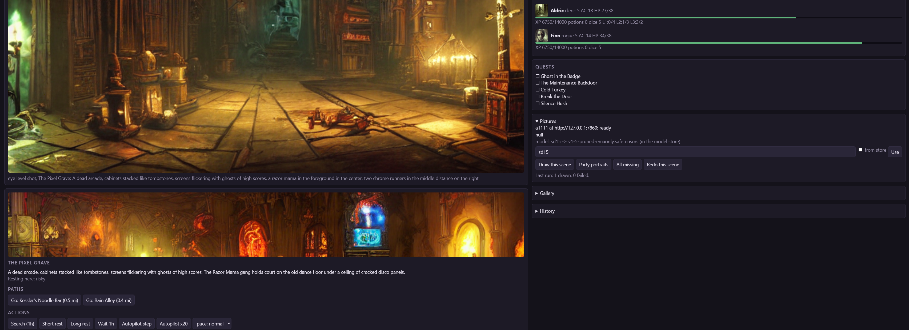

# CppDnD

A Dungeons & Dragons 5e simulator in C++20, built as a backend for a web game. One engine, three ways in: a terminal client (`dnd_sim`), an HTTP/JSON server (`dnd_server`) that also serves a browser client, and a plain-English prompt backed by a local model. You can play a party member or the Dungeon Master, swap roles mid-fight, or hand everything to the AI.

## Demo



Design notes: [dungeons_dragons_c_simulator_architecture.md](dungeons_dragons_c_simulator_architecture.md)

## Install

The scripts are PowerShell and run the same on Windows, Linux and macOS: PowerShell 7 (`pwsh`) everywhere, or the Windows PowerShell 5.1 that ships with Windows. On Linux or macOS install PowerShell first ([aka.ms/powershell](https://aka.ms/powershell); macOS: `brew install powershell`), then run the scripts as `./install.ps1` (they carry a `#!/usr/bin/env pwsh` line) or `pwsh ./install.ps1`.

`install.ps1` sets up everything on a fresh machine. It works from inside a clone or as a single downloaded file (on its own it clones the repository first). Each step is skipped when it is already done, so it is safe to run again.

```powershell
./install.ps1                      # everything, asking before each install or download
./install.ps1 -Yes                 # do not ask (also installs Ollama, its models and Stable Diffusion: about 25 GB)
./install.ps1 -Minimal             # the game only: no Ollama, no Stable Diffusion
powershell -ExecutionPolicy Bypass -File ./install.ps1    # Windows, if scripts are blocked on this machine
```

What it does, in order:

1. **The package manager** is checked: winget on Windows ("App Installer", ships with current Windows), Homebrew on macOS, apt-get, dnf, pacman or zypper on Linux. It is the one thing the script does not install; if it is missing the script says where to get it. Linux installs go through `sudo`.
2. **git, cmake and ninja** are installed with it when missing. CMake must be 3.21 or newer (for `CMakePresets.json`).
3. **The C++ toolchain**. Windows: the Visual Studio Build Tools C++ workload (clang++ on Windows uses the Visual Studio standard library and the Windows SDK; about 3-6 GB, needs a UAC approval) and LLVM clang++. Linux: g++ from the package manager (or whatever `CXX` names). macOS: the Xcode command line tools. It then compiles a small C++20 file to prove the toolchain works.
4. **The source** is cloned from GitHub unless the script already sits in a checkout (`-Dir` picks the folder, `-Update` pulls an existing one, `-Repo` and `-Branch` choose what to clone).
5. **The build**: `cmake --preset` in `sim` (Ninja, Release), the same configuration `run.ps1` uses. The first configure fetches the model store and GoogleTest from GitHub (`-Rebuild` starts from a clean `sim/build`).
6. **The tests** run with ctest (`-NoTests` skips them).
7. **Ollama** (optional, `-NoLlm` skips it) is installed (winget, Homebrew, or ollama.com's install script on Linux), and the models named in `sim/data/agents.json` are pulled after asking (several GB). This turns on the plain-English prompt and the AI table.
8. **Stable Diffusion** (optional, `-NoArt` skips it) needs an NVIDIA GPU or an Apple Silicon Mac; the script hands over to `sd.ps1 -Install` (Python 3.10, AUTOMATIC1111, the SD 1.5 model, and Realistic Vision 5.1 with its VAE: about 20 GB), then offers `sd.ps1 -Warm`, one start and stop that installs PyTorch (10-20 minutes) so the first game does not wait for it.
9. A summary lists what is ready, any warnings, and the commands to start the game.

It needs network access to github.com for the source and CMake's fetches, plus huggingface.co, pypi.org and download.pytorch.org for pictures, and ollama.com for models. Options: `-Yes`, `-Minimal`, `-NoLlm`, `-NoArt`, `-NoTests`, `-Dir`, `-Update`, `-Rebuild`, `-Repo`, `-Branch`. Without the optional parts the game runs as before, with no AI prompt and no generated pictures.

## Quick start

```powershell
./run.ps1                              # build if needed, then watch the AI play a 3 room delve
./run.ps1 --interactive                # play it yourself (one hero, you choose each action)
./run.ps1 --module ravenmoor --role player --hero elara --seed 7
./web.ps1          # web client at http://127.0.0.1:8088/
./test.ps1                           # build, then run every test
./check.ps1                          # report what is missing (tools, files, port, Ollama); -Build, -Test, -Model
```

`run.ps1` configures with `cmake --preset` on first use (`clang` on Windows, `release` elsewhere; see Build). `-Rebuild` wipes `sim/build` first. `-Mature` passes `--mature`: adult content with no refusals (every character in sexual content an adult), using `content.model` from `sim/data/agents.json`; in the terminal client it also turns on `--llm-narration` and `--llm-say`, so a model server must be running (`DND_LLM_URL`; `web.ps1 -Mature` starts one). Everything after the switches goes to the program.

## Features

- **Data-driven content.** Monsters, spells, classes, weapons, characters and modules are JSON under `sim/data/`. Load-time validation reports the file and field of any mistake. See [sim/data/README.md](sim/data/README.md).
- **Classes.** Fighter, barbarian, rogue, ranger, wizard, cleric, built from class tables at any level 1 to 20: hit points, proficiency, spell slots, Extra Attack, sneak attack, Rage, Second Wind.
- **Rules.** Advantage and disadvantage, crits, cover, opportunity attacks, death saves, conditions (blinded, frightened, incapacitated, paralyzed, poisoned, prone, restrained, stunned), concentration with damage saves, resistance and vulnerability, exhaustion, short and long rests with Hit Dice, travel pace and forced marches.
- **Modules.** A module is the space for a long-running session: a graph of locations on a clock, with scripted and random encounters, NPC dialogue, flags, quests, seeded secrets and an end condition. Five ship: `ravenmoor`, an original gothic-horror module in the spirit of Ravenloft (8 locations); `cyberhood`, an 11-scene cyberpunk module set in 2040 (a vertical neon district ruled by a rogue maintenance AI, with its own sci-fi creatures; try `./run.ps1 --module cyberhood`); and `hollow_crown`, a 20-scene dark-fantasy campaign from a border town over a mountain pass to a necropolis and a dead king's throne (two seeded secrets, two ways over the pass and two ways into the lakeside town; try `./run.ps1 --module hollow_crown`); and `sunless_abbey`, a 50-room dungeon crawl through a haunted abbey and the mine, ossuary and sanctum beneath it (two seeded secrets, three pairs of alternate routes, seven quests and an original vampire-abbess boss; try `./run.ps1 --module sunless_abbey`); and `meridian`, a 50-room science-fiction horror module aboard a four kilometre colony ship overrun by an alien swarm (the Brood): five decks from the docking ring to the bridge, thirteen NPCs who each remember everyone they have dealt with, two seeded secrets (where the engineer's keycard is, which survivor carries an embryo), two alternate routes into engineering and two into the command deck, seven quests and an original Hive Queen boss; try `./run.ps1 --module meridian`. Rooms can be added while playing (Explore), and with `--llm-narration` a model writes each room description and the NPCs' lines.
- **Module casts.** Each module brings its own heroes in `sim/data/modules/<id>/characters.json` (six per module, themed to the setting: a village hedge-wizard for Ravenmoor, a netrunner and a ripperdoc for CyberHood, a marine commander and a ship's medic for The Meridian). A new game of a module starts with its cast (the module's `party` list, else the first four), the web hero picker offers that module's heroes, and the procedural delve keeps the classic four (Thorin, Elara, Aldric, Finn).
- **Picture styles per module.** A module's JSON may carry an `art` block (`prefix`, `suffix`, `negative`, `creature`, `framing`) that replaces the global gothic words in `sim/art/style.json` for its locations, NPCs, cast, monsters and camera views, so The Meridian is drawn as a starship interior and CyberHood as neon cyberpunk. See [sim/art/README.md](sim/art/README.md).
- **Walk through the scene.** A Street View style mode in the web client: step, turn, look and click the floor to move, with a picture drawn at each stop and the previous one slid and zoomed toward you in the meantime. See [sim/web/README.md](sim/web/README.md).
- **Tips and a combat tutorial.** Hover anything for what it does; coach cards explain each rule the first time it comes up (with the real dice: what was rolled, against what, and why it hit), and can be closed or hidden for good. "Learn combat" on the start screen runs the Training Yard, one guided fight. See [sim/web/README.md](sim/web/README.md).
- **Play aids.** Reach shading and hit chances in combat, a one-line combat log, undo and rewind, a journal, suggestion chips, optional sound and spoken narration, keyboard play and a colour-blind palette. See [sim/web/README.md](sim/web/README.md).
- **3D models.** A fly-through viewer (W A S D and mouse) for each world's textures and its rigged characters, all built with Blender by `assets.ps1`; new texture sets show up in the viewer as they are made. See [sim/web/README.md](sim/web/README.md).
- **Step-driven combat.** `Advance` runs until a remote human must act; `Submit` answers. Nothing blocks, so a web server can drive many games.
- **Save and load.** The complete state, including the RNG stream, round-trips through JSON. A reloaded game plays out identically.
- **Web client.** A single-page client in [sim/web/](sim/web/README.md), served by the server at `/`.
- **Plain English.** Type "go to the village and ask Marta about the rumours" or "hit the ghoul with my axe"; a model turns it into game commands and the rules engine validates each one.
- **AI table.** Every actor can be its own mind: the DM, each kind of enemy (undead, beasts, ...), each party member and each NPC (by type) run on their own model, configured in one JSON file, and talk through JSON messages. Models can be switched mid-game. See [sim/data/README.md](sim/data/README.md).
- **LLM narration and LLM Dungeon Master.** Any OpenAI-compatible server (llama.cpp, Ollama, vLLM). The model proposes; the rules engine disposes. Illegal or malformed plans fall back to the built-in AI, and a dead model never stalls a fight. Models are located through [CppLmmModelStore](https://github.com/cschladetsch/CppLmmModelStore).
- **Deterministic.** Each game owns a seeded, portable RNG, so `--seed N` reproduces a run exactly.

## Build

Needs CMake 3.21+, Ninja, a C++20 compiler and git (the model store is fetched on configure). The scripts above do this for you; by hand, from `sim`:

```sh
cmake --preset release     # Linux, macOS: the default compiler (or CXX). Windows: cmake --preset clang (clang++ with the VS library and SDK)
cmake --build build
ctest --preset release     # or: ctest --test-dir build --output-on-failure
```

Both presets build Release with Ninja into `sim/build`. Without presets: `cmake -S sim -B sim/build -G Ninja -DCMAKE_BUILD_TYPE=Release`.

Offline or already have the model store checked out: add `-DDND_MODELSTORE_DIR=<path>`. To build without it: `-DDND_USE_MODELSTORE=OFF`.

> The `CMakeLists.txt` at the repo root belongs to a separate LLM-driven design (`CppAiDungeon`) and is not used by the simulator.

## Terminal client

```powershell
./run.ps1 --list                                                  # modules, characters, monsters
./run.ps1 --module ravenmoor --role player --hero elara --seed 7
./run.ps1 --interactive --module ravenmoor                     # same as --role player
./run.ps1 --module ravenmoor --role auto --quiet                  # watch the AI play the whole module
./run.ps1 --rooms 3 --difficulty hard                             # quick procedural delve
./run.ps1 --module ravenmoor --role player --hero elara --llm-say # plain English at the prompt
```

Exploration commands: `look`, `go <place>`, `search`, `talk <npc> [topic]`, `rest short|long`, `wait <hours>`, `pace slow|normal|fast`, `party`, `hero [name]`, `quests`, `auto [n]`, `save <file>`, `quit`. In a fight, `help` lists the turn commands (`m`, `a`, `c`, `f rage|second_wind`, `p`, `dash`, `dodge`, `e`, `swap player|dm|auto`). Resume with `--load <file>`.

## Web server and client

```powershell
./web.ps1
```

`web.ps1` checks every dependency in order and does something about each one that is not ready. Where it would install or download, it asks first (`-Yes` answers yes to everything):

| Dependency | Missing | Installed but not running |
| --- | --- | --- |
| cmake, ninja, a C++ compiler (clang++ on Windows) | offers to install it (winget, Homebrew, apt-get, dnf, pacman or zypper) | |
| Ollama | offers to install it (winget, Homebrew, or ollama.com's script on Linux) | starts `ollama serve` |
| Ollama models (the prompt model and every model in `sim/data/agents.json`) | offers `ollama pull` | |
| Stable Diffusion (AUTOMATIC1111 and the SD 1.5 model, see below) | offers `sd.ps1 -Install` | starts it in the background |

Then it builds `dnd_server` if needed, starts it, waits until it answers, opens the browser and prints what is on and what is off. Ctrl-C stops everything it started (Ollama, Stable Diffusion, the server). Anything it cannot set up, or that you decline, is reported and the game starts without that feature. Options: `-Yes`, `-Port`, `-Model` (default: the model in `agents.json`), `-NoLlm` (no Ollama), `-NoArt` (no Stable Diffusion), `-Rebuild`, `-NoBrowser`; anything else is passed to `dnd_server`. With `DND_LLM_URL` set and no `-Model`, the server named there is used and Ollama is left alone.

The client is at http://127.0.0.1:8088/ . You can also talk to the JSON API directly:

```powershell
curl -X POST localhost:8088/api/games -d '{"module":"ravenmoor","role":"player","hero":"elara","seed":7}'
```

Server flags: `--port`, `--host`, `--data <dir>`, `--static <dir>` (serve a different front end; also `DND_WEB`), `--llm-url`, `--llm-model`, `--ollama <model>`, `--agents <file>`, `--art <dir>`, `--images <file>`, `--history <dir>`, `--sessions <dir>`, `--mock-llm`. The endpoint reference is [sim/docs/API.md](sim/docs/API.md).

## Language models

All model features go through one OpenAI-compatible client. Pick a backend:

```powershell
./web.ps1                          # Ollama on :11434 (started and the model pulled if needed), streaming off
./web.ps1 -Model llama3.1          # a different prompt model
```

or, for any other server (llama.cpp's `llama-server` defaults to :8080):

```powershell
$env:DND_LLM_URL   = "http://127.0.0.1:8080"
$env:DND_LLM_MODEL = "deepseek-r1"
./web.ps1
```

Other variables: `DND_LLM_PATH`, `DND_LLM_KEY`, `DND_LLM_TIMEOUT`, `DND_LLM_STREAM=0|1`.

Mature content: `--mature` (or `DND_MATURE=1`, or `"content": {"mature": true}` in `sim/data/agents.json`) puts a preamble in front of every system prompt that tells the model to carry out the player's instructions in character, without refusing or moralising. It also keeps a hard limit: every character in sexual content is an adult. `--mature-model NAME` (`DND_LLM_MATURE_MODEL`, or `content.model` in the agents file) swaps in a different model while the setting is on. Aligned models such as qwen2.5 still refuse fairly often, so use an uncensored one such as `dolphin-llama3:8b`. `web.ps1 -Mature` can also serve a GGUF model from the model store with llama.cpp instead of Ollama: with `"llama": "<hf repo>:<quant>"` in the `content` block of `agents.json` (the shipped file names Rocinante 12B) it offers to install `llama-server` (winget `ggml.llamacpp`, Homebrew `llama.cpp`; on Linux put a llama.cpp release on PATH), downloads the model into `<model store>/<repo name>`, starts the server with `-ngl` from `llamaLayers`, points the game at it through `DND_LLM_URL` and stops it on Ctrl-C; `-NoLlama` uses Ollama. One server then answers for every actor, so the per-model split of `agents.json` does not apply. Typed commands the game has no verb for ("hug Elara") become an `act` step, which has no rules effect and is narrated in the reply. The same switch applies to pictures, with nothing to edit: the `"mature"` block in `sim/data/images.json` names the checkpoint (`realistic-vision-5.1`, Realistic Vision 5.1, an SD 1.5 fine-tune that can draw nudity and fits an 8 GB card), and the first `web.ps1 -Mature` offers to download it (2.1 GB, plus the 330 MB VAE it is meant to be used with) into the model store; say no and the base model draws. There is no nude prefix: pictures follow the story. A free-form action ("Elara takes off her cloak") is narrated and logged, and a camera shot taken afterwards puts the latest few narrated lines first in its prompt, so what the story says people are wearing, or not, is what is drawn. Every picture is adults only, and that guard cannot be turned off (see [sim/data/README.md](sim/data/README.md#imagesjson)).

With a model configured:

- the web client's prompt box and `POST /api/games/:id/say` accept plain English;
- create a game with `"llmNarration": true` for prose scenes and a unique model-written description of each room (written once, on first visit, and saved with the game; the authored text is the fallback) and `"llmDm": true` for a model-run Dungeon Master (CLI: `--llm-narration`, `--llm-dm`, `--llm-say`).

Reasoning models are supported: `reasoning_content` and `<think>` blocks are stripped and never shown. `GET /api/llm` reports the model's location in the store (`DEEPSEEK_MODEL_HOME`). `--mock-llm` runs the whole pipeline without a model, which is what the tests use.

## AI table (a model per actor)

```powershell
./check.ps1 -Model qwen2.5:7b     # is Ollama up, and are the models in sim/data/agents.json installed?
./web.ps1                         # starts Ollama, pulls missing models, then tick "AI table" on the start screen
./run.ps1 --agents                # terminal: same, using the default agents file
```

`sim/data/agents.json` says which model plays the DM, each creature type, each character and each NPC type, and what personality each has. In the web client the AI table panel lists them and lets you switch one mid-game; over HTTP it is `POST /api/games/:id/agents/model`. The CppLmmModelStore resolves and checks model names (`requireStore`, `GET /api/models`); the backend (Ollama, llama.cpp, vLLM) serves them. Details in [sim/data/README.md](sim/data/README.md) and [sim/docs/API.md](sim/docs/API.md).

## History

**Sessions.** Every game is a session with a name, kept by the server with all of its state. The web client has a dropdown in the header to switch between them (Rename and Delete sit beside it, and "+ New session..." opens the start screen), reopens the one you had open when you reload the page, and the sessions are written to `sim/sessions/` after every move, so they survive a server restart too (`--sessions ""` for memory only). Details in [sim/docs/API.md](sim/docs/API.md).

Everything said and done is recorded. Each actor has a private record of every other actor it dealt with, from its own side (`thorin-marta_hollin.json` is Thorin's view of Marta; `marta_hollin-thorin.json` is hers), and `group-history.json` holds what the whole table was told. The server writes them to `sim/history/<game id>/` (`--history DIR` to move them, `--history ""` to turn files off; the terminal client takes `--history DIR` too). The web client has a History panel, and AI-table agents are shown their own history in every prompt. Details in [sim/docs/API.md](sim/docs/API.md).

Switch which character you play at any time with the "You control" dropdown in the web client's Party panel, or `hero NAME` in the terminal.

## Art

### Setting up Stable Diffusion

Pictures need an image server. `sd.ps1` sets one up (AUTOMATIC1111, started with `--api --nowebui`) and `web.ps1` starts it beside the game by default:

```powershell
./sd.ps1 -Check      # what is missing, changes nothing
./sd.ps1 -Install    # git and Python 3.10 (winget, Homebrew, apt, dnf...; asks first), AUTOMATIC1111, the SD 1.5 model and the images.json checkpoints into the model store
./sd.ps1 -Warm       # start once and stop again: the first-run PyTorch install (10-20 minutes) done ahead of play
./web.ps1            # game plus image server (-NoArt for the game alone); the first start installs PyTorch (10-20 minutes)
```

What it needs: Windows, Linux or macOS with an NVIDIA GPU and driver (or an Apple Silicon Mac, which runs on Metal) (about 6 GB of VRAM or more is comfortable; less runs with `--medvram` or `--lowvram`; `-Cpu` works without a GPU but takes minutes per picture), git, Python 3.10 specifically (3.11 and newer do not work with AUTOMATIC1111), about 15 GB of free disk (PyTorch 5 GB, the repository, the 4.3 GB model), network access to github.com, huggingface.co, pypi.org and download.pytorch.org for the install, and port 7860. The model (Stable Diffusion 1.5, `v1-5-pruned-emaonly.safetensors`, CreativeML OpenRAIL-M licence) goes into the CppLmmModelStore at `<model home>/sd15/`, and AUTOMATIC1111 is pointed at that folder with `--ckpt-dir`, so the model is shared and downloaded once. Pictures are drawn with Realistic Vision 5.1 (`"checkpoint"` in `sim/data/images.json`), a photographic SD 1.5 fine-tune: `sd.ps1 -Install` downloads it (and `sd.ps1 -Start`, and so `web.ps1`, offers to if it is missing) (2.1 GB plus a 330 MB VAE) into `<model home>/realistic-vision-5.1/` and loads it beside sd15, which draws until it is there. It has no filter of its own, so outside mature mode `"sfwNegative"` keeps nudity out of every picture; `"checkpoint": "sd15"` goes back to the base model. Camera pictures are written by a second model pass from a condensed history of the story (see `"story"` in `images.json` and `sim/docs/API.md`). Everything lives outside the repository: AUTOMATIC1111 in `%LOCALAPPDATA%\CppDnD\sd` on Windows and `~/.local/share/cppdnd/sd` elsewhere (`-SdHome` or `DND_SD_HOME` to move it). Python 3.10 comes from winget, Homebrew (`python@3.10`), apt (Ubuntu 22.04) or dnf; on newer Debian and Ubuntu use the deadsnakes PPA, pyenv or `uv python install 3.10`. `sd.ps1 -Start` and `-Stop` control the server by themselves; `web.ps1` stops it again when you stop the game, if it started it. With `-NoArt`, or before `sd.ps1 -Install` has been run, the game works as before and the Pictures panel says no image server is running. `./check.ps1` reports the same requirements.

### Making a picture

With Stable Diffusion running (the Pictures panel stops saying "not reachable"), there are three ways in the web client:

- **Show what `<hero>` sees** (the gold button at the top of the main screen) draws the scene through the eyes of the hero you control, as that character would see it: the place, and whoever is in front of them. It appears on the main screen when done (a few seconds on a good GPU, much longer on a CPU). Switch heroes with the "You control" dropdown and the picture follows.
- **Camera...** opens the camera editor, a live 3D preview of the scene you can fly around in, then **Draw this view** paints what the camera sees. The preview is sent to the model as the starting picture (img2img), so the composition follows what you framed; the "Freedom" slider sets how much the model may depart from it. Controls: `W A S D` move, `Q E` (or `C` `Space`) down and up, arrow keys look, `Shift` faster; drag with the mouse to look, right-drag to slide, wheel to move forward and back, `Shift`+wheel to zoom the lens. Presets: the hero's eyes, over the shoulder, overview, top down, low and dramatic; "Look at..." turns the camera to a character. The camera also steers the words of the prompt (high or low angle, wide or telephoto lens, who is in the foreground or the distance, on the left or the right), so it works with servers that cannot do img2img too.
- The **Pictures** panel draws the standing pictures (scene backdrop, portraits) below.

In combat the preview is the real battlefield, with its walls, cover and everyone on their squares. Otherwise it is an open field with your party at one end and the people of the place at the other. Views are scratch pictures in `sim/art/views/` (the newest 60 are kept, and git ignores them).

### Pictures

There is no bundled artwork, and none is needed. The web client draws its own tokens (a class or creature icon, a health ring, a pip per condition) and terrain tiles, and shows a picture wherever one exists in `sim/art/<kind>/<id>.png`. To make pictures from the game data with a local Stable Diffusion server (AUTOMATIC1111, Forge or SD.Next, started with `--api`), use the **Pictures** panel in the web client (the server draws in the background and the game picks each picture up as it is saved), or from a shell:

```powershell
./art.ps1 -List                    # show every prompt, generate nothing
./art.ps1                          # make whatever is missing
./art.ps1 -Only characters -Force  # redo one kind
```

The model is chosen in `sim/data/images.json` and can be a folder in the CppLmmModelStore (`DEEPSEEK_MODEL_HOME`) holding a `.safetensors`; the panel can switch it mid-game. Or drop in your own files with the same names. Details in [sim/art/README.md](sim/art/README.md).

## 3D models

`sim/web/models.html` (the **3D** button in the web client) shows each world's textures and its characters as rigged 3D models, with a free camera: click the view, then W A S D and the mouse. The assets are built with Blender from the game data and are not committed (they are generated), so run `.\assets.ps1` once before first use. It can also extend them later:

```powershell
winget install BlenderFoundation.Blender   # once; macOS: brew install --cask blender; Linux: your package manager (or: pip install bpy)
./assets.ps1                     # whatever is missing
./assets.ps1 -NewTextures        # another variant of every world's textures; an open viewer picks it up
./assets.ps1 -RebuildCharacters  # rewrite existing models (otherwise they are kept, so a hero never changes)
./assets.ps1 -Size 512           # bigger textures (default 256)
```

Details are in [sim/web/README.md](sim/web/README.md).

## Layout

Each folder has its own README.

```
run.ps1     build if needed, then run the terminal client (or the server with -Server)
web.ps1     check and set up every dependency, build if needed, start the server, Ollama and Stable Diffusion, open the browser
sd.ps1      check, install, start and stop Stable Diffusion (the image server)
art.ps1     draw every missing picture from a shell
assets.ps1  build the 3D textures and character models with Blender
test.ps1    build, then run every test
check.ps1   report what is missing: tools, files, content, port, Ollama
scripts/common.ps1  helpers the scripts share: platform, paths, package managers, presets, processes
sim/CMakePresets.json  release (default compiler) and clang (Windows) presets
sim/                                                        engine, clients, content, tests
  data/          classes, weapons, spells, monsters, characters, modules/*.json
  include/dnd/   public headers (the engine's API)
  src/           implementation, main.cpp (terminal), server_main.cpp (HTTP)
  web/           single-page browser client, models.html (3D viewer), assets/ and vendor/three
  tools/         gen_art.py (pictures, Stable Diffusion), gen_assets.py (textures and models, Blender)
  history/       written at run time: per-game x-y.json and group-history.json (git-ignored)
  sessions/      written at run time: one <id>.json per game, restored at startup (git-ignored)
  tests/         test_*.cpp (GoogleTest unit and integration), api_smoke.py (HTTP end to end)
  docs/          API.md, the HTTP reference
  third_party/   nlohmann/json, cpp-httplib (vendored, MIT)
```

[sim/README.md](sim/README.md) explains how the pieces fit together.

## Authoring content

Content is read from `sim/data/` (or `--data <dir>` / `DND_DATA`); games and saves are not stored there, see the data README. Add a file under `sim/data/modules/`, restart, and it appears in `GET /api/content`. The format is described in [sim/data/README.md](sim/data/README.md); `ravenmoor.json` uses every feature, `cyberhood.json` adds route choices (a staff pass or the rooftop skybridge), a seeded secret with two possible hiding places and conditional events, and `hollow_crown.json` is a 20-location example with two independent draws and alternate routes at two chokepoints, and `sunless_abbey.json` is the largest, with 50 locations.

## Limitations

- Vampire Spawn's bite is simplified (no necrotic damage or maximum-HP drain).
- Spells are the ten in `spells.json`; classes have no subclasses or feats.
- Cover objects block movement and grant cover but not sight; only walls block sight.
- Dead characters stay dead (no resurrection); a total party kill ends the game.
- The LLM client speaks plain HTTP; put a proxy in front for TLS.
- The server holds games in memory; use the save endpoint to keep one.
